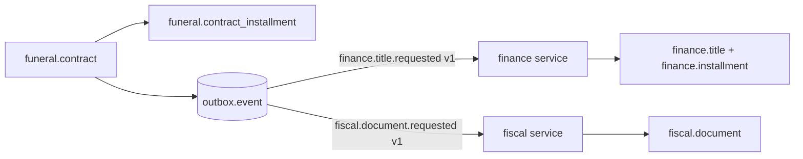

# ADR 0017 — Parcelamento do contrato funerário e eventos de integração

Status: aceito para FUN-01B (#32)
Data: 2026-11-25

## Contexto

O contrato funerário da ADR 0016 congela o valor dos itens, mas ainda não
guarda seu plano de cobrança. A emissão de parcelas precisa ser determinística
e não pode criar cobrança duplicada quando a operação for repetida pelo relay
ou pela outbox.

`funeral`, `finance` e `fiscal` são módulos com schemas próprios. Portanto, o
funeral não pode inserir ou consultar `finance.title`/`finance.installment`, e
finance não pode fazer JOIN nas tabelas funerárias. A integração deve ocorrer
por eventos versionados e idempotentes.

## Decisão

1. O funeral persiste o snapshot append-only em
   `funeral.contract_installment`. Cada linha contém `number`, `amount`,
   `due_date` e `status=scheduled`, com unicidade por contrato e número.
2. A API aceita `payment_plan.installment_count`,
   `payment_plan.first_due_date` e `payment_plan.interval_months`. A contagem
   padrão é 1; o intervalo padrão é mensal. O valor é dividido em centavos:
   a parte inteira vai para todas as parcelas e o resto é distribuído nas
   primeiras parcelas, garantindo soma exatamente igual ao contrato.
3. A primeira data é obrigatória para um plano informado. Sem plano explícito,
   a única parcela vence na data UTC da criação. Datas seguintes usam
   `time.AddDate(0, interval_months, n)`; não há regra fiscal ou financeira
   implícita além dessa geração aritmética.
4. A criação do contrato, suas parcelas e os eventos são uma única transação.
   Replay da mesma `Idempotency-Key` devolve o agregado já persistido; replay
   divergente falha. A outbox usa chaves estáveis por contrato:
   `finance.title.requested:<contract_id>` e
   `fiscal.document.requested:<contract_id>`.
5. A criação publica, em v1:
   - `finance.title.requested`, com referências opacas, valor total e a lista
     de parcelas;
   - `fiscal.document.requested`, com referência do contrato, empresa,
     cliente, competência da criação e valor total, sem alíquota, CST,
     cClassTrib ou qualquer regra fiscal inventada.
6. O consumidor financeiro deve usar a chave do evento como sua chave de
   idempotência do título e a unicidade `(title_id, number)` para as parcelas.
   O consumidor fiscal deve usar a mesma estratégia para seu documento. Nesta
   fatia os consumidores de negócio ainda não estão ligados ao worker; ligar
   múltiplos destinos exige a evolução do modelo single-consumer da ADR 0009.
7. `finance.title` recebe uma chave de idempotência opcional persistida para
   permitir esse consumo sem duplicação. Nenhum módulo passa a ler tabela de
   outro módulo.

## Diagrama de fronteira

## Critérios de aceite

- Soma das parcelas é igual ao total congelado do contrato, inclusive quando
  há resto de centavos.
- O vencimento mensal respeita o calendário de `AddDate`, sem float e sem
  conversão de fuso na data de negócio.
- Replay idêntico não duplica contrato, parcelas ou eventos; chave divergente
  retorna conflito.
- Falha em qualquer insert de parcela ou evento faz rollback do contrato e de
  todas as parcelas.
- RLS com `amparius_app` `NOSUPERUSER NOBYPASSRLS` isola tenant; empresa do
  contexto limita a leitura do contrato.
- Payload dos dois eventos não contém PII nem regra/valor fiscal estimado.
- Teste PostgreSQL real usa DSN da aplicação e DSN administrativo separado e
  confirma cleanup sem resíduos.

## Consequências e limites

- O plano do contrato é um snapshot comercial; baixa, juros, desconto e
  situação financeira continuam pertencendo a `finance`.
- A tabela funerária não é uma segunda cobrança: ela é a fonte do plano que o
  evento entrega ao serviço financeiro. O consumidor ainda precisa ser
  implementado em uma fatia própria.
- A solicitação fiscal não autoriza emissão e não calcula tributo. O motor
  fiscal deve resolver tabelas oficiais datadas quando o consumidor for
  implementado.
- Eventos continuam at-least-once. A deduplicação de efeitos depende do
  consumidor usar as chaves descritas; o dispatcher atual só registra entrega
  de infraestrutura.
