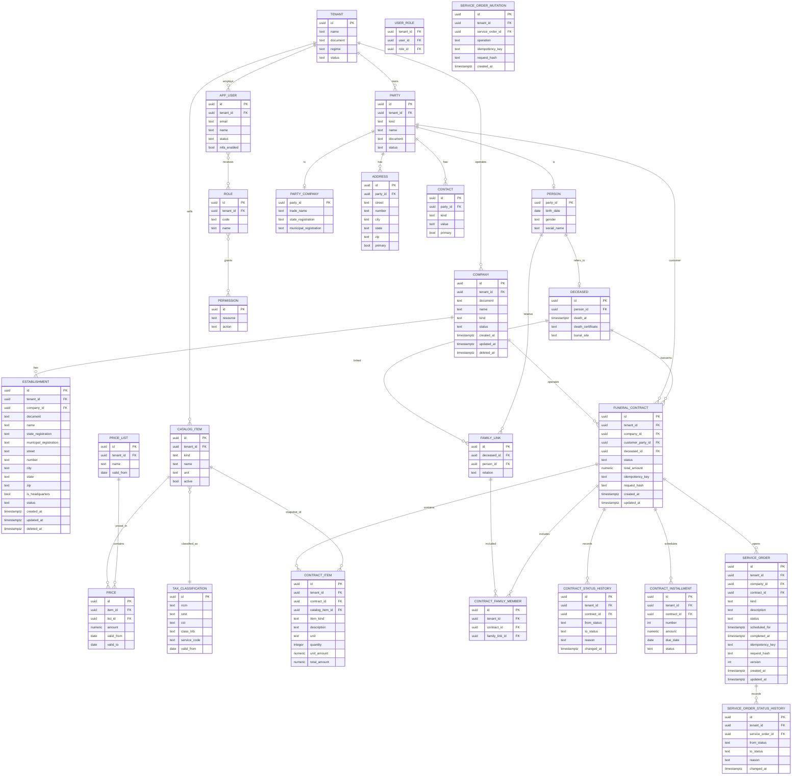
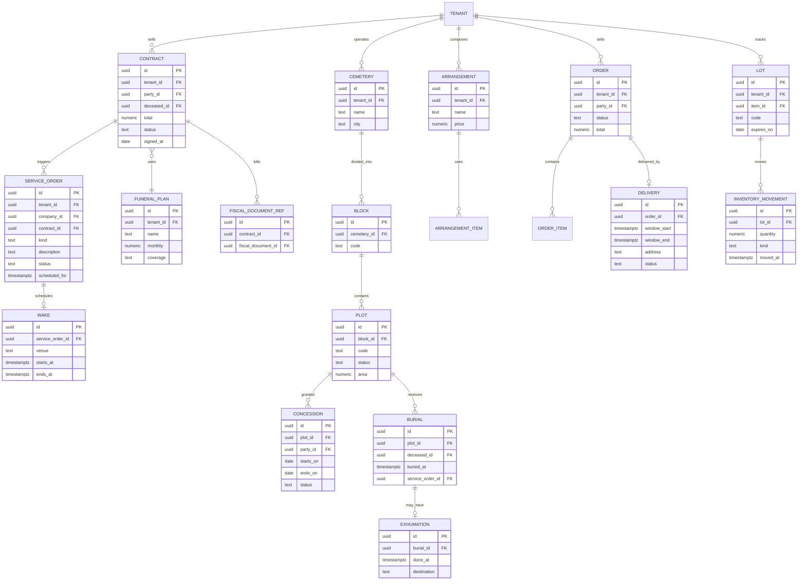
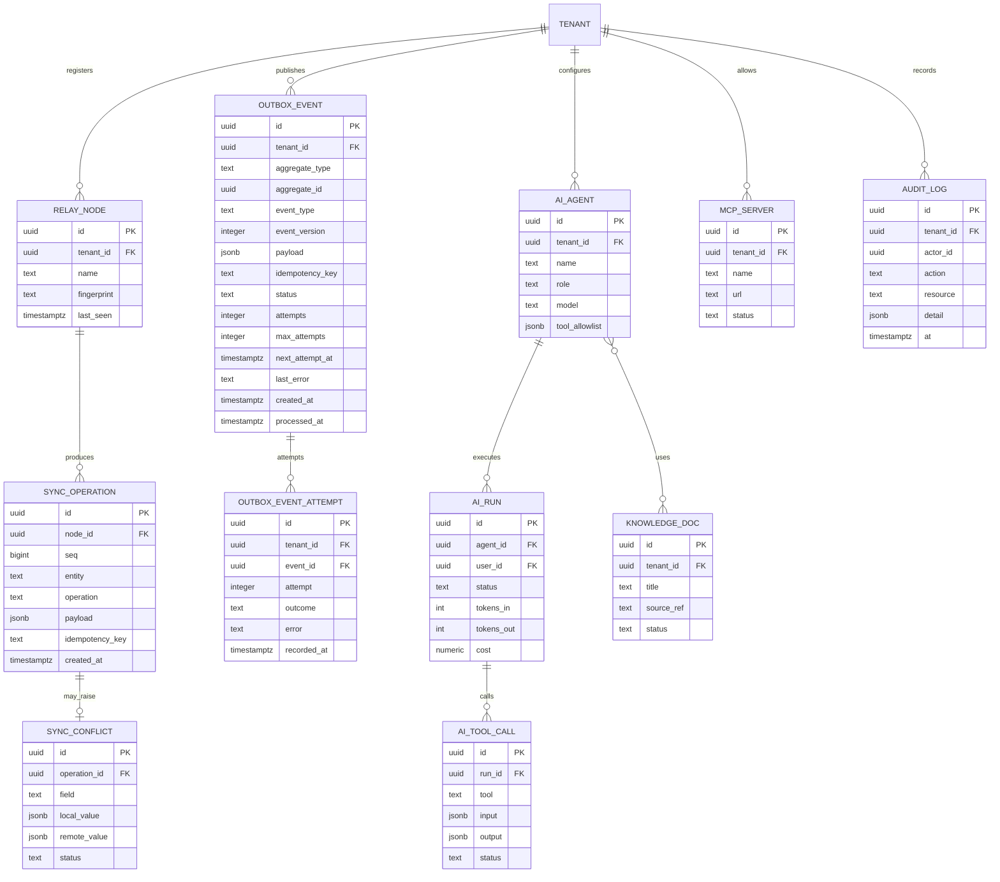
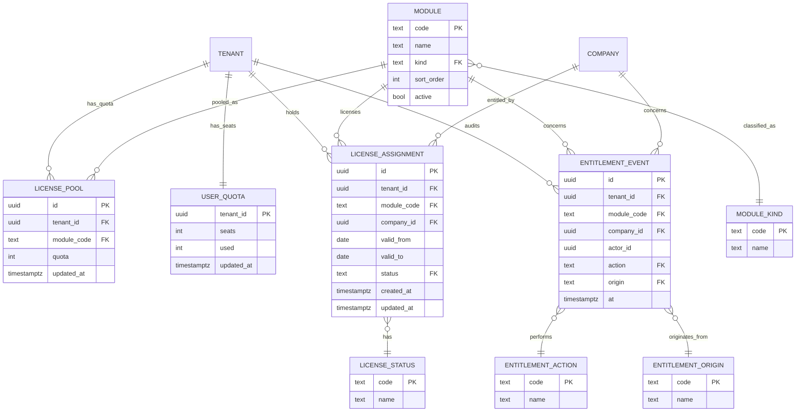
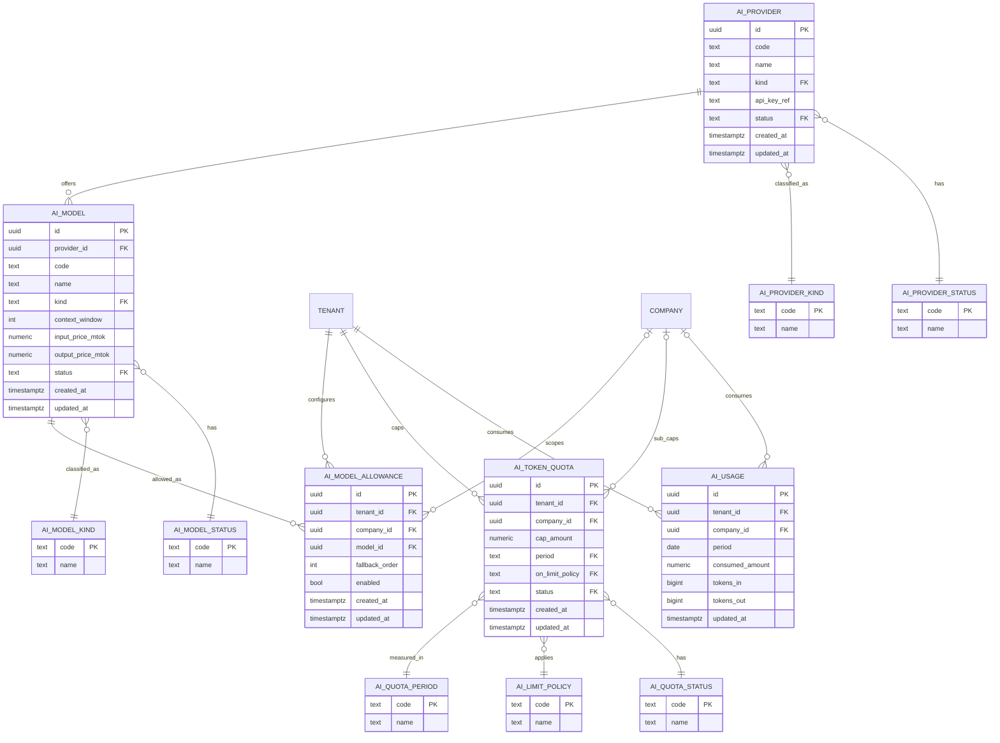

# DER — Amparius

Versão 0.7 · modelo lógico inicial + entidade legal, estabelecimento, onboarding, nome social (ADR 0013), entitlement (ADR 0007), provedores/modelos/cota de IA (ADR 0008), contrato funerário (ADR 0016) e ordem de serviço (ADR 0018). Diagramas em Mermaid; nomes em `snake_case`; toda tabela de negócio carrega `tenant_id`.

> **Decisão de nomes (ADR 0007 §7):** `COMPANY` é a **entidade legal operadora** (CNPJ raiz — a funerária, o cemitério, a floricultura). O subtipo de cadastro de PJ cliente/fornecedor, antes chamado `COMPANY`, passa a se chamar **`PARTY_COMPANY`**. Não existem duas entidades com o mesmo nome. `ESTABLISHMENT` substitui `BRANCH`.

## 1. Núcleo: identidade, cadastro e catálogo



### Contrato funerário (ADR 0016)

`funeral.contract` não duplica cadastro de cliente, falecido ou familiar. O
cliente é uma `party`, o falecido é um `deceased` e os familiares são
`family_link` existentes do mesmo falecido. `contract_item` congela os dados do
item e o valor em centavos para preservar o contrato mesmo que o catálogo mude.
`contract_status_history` é append-only; o agregado e as referências têm RLS
por tenant e também filtram a empresa do contexto na aplicação.

### Ordem de serviço (ADR 0018)

`funeral.service_order` é a unidade operacional aberta a partir de um contrato
ativo. A descrição e o tipo são dados da OS, não uma cópia de party; a outbox
publica somente IDs opacos, estados e datas. `service_order_status_history` e
`service_order_mutation` são append-only e têm RLS por tenant. A empresa do
contexto limita leitura e escrita na aplicação.

### Nome social e nome de exibição

`party.party.name` permanece o nome civil obrigatório. `party.person.social_name`
é opcional e anulável; ausência ou valor vazio é persistido como `NULL`, sem
backfill dos cadastros existentes. A leitura operacional resolve
`display_name`: usa `social_name` quando não vazio e, caso contrário, usa
`party.party.name`. Pessoa jurídica usa sempre `party.party.name`.

`display_name` é semântica de apresentação, não uma coluna persistida nem
identificador fiscal, chave de deduplicação ou autorização. Contextos formal,
fiscal e de auditoria selecionam explicitamente o nome civil. `DECEASED` e
`FAMILY_LINK` continuam referenciando `PERSON` e não duplicam qualquer nome;
suas leituras resolvem `display_name` na origem.

### Onboarding inicial

`identity.app_user` é o armazenamento mínimo do usuário do tenant. O vínculo
do proprietário é `identity.user_role` com `role.code = 'owner'`. A migration
`0009_identity_onboarding.sql` também cria `identity.onboarding_request`, cuja
chave é global para garantir idempotência do bootstrap e cujo `tenant_id` é
protegido por RLS.

O caminho pré-autenticação chama `identity.create_onboarding` sem receber
`tenant_id`; o banco gera o UUID e cria tenant, empresa, estabelecimento,
usuário e papel na mesma transação. O usuário inicial fica `pending_auth`.
Senha, sessão, MFA e vínculo OIDC não fazem parte deste contrato.

### Parcelamento e integração do contrato (ADR 0017)

`funeral.contract_installment` é o snapshot comercial append-only. A soma de
suas parcelas é exatamente `contract.total_amount`; o restante de centavos é
distribuído nas primeiras parcelas. O funeral não cria `finance.title` nem
`finance.installment`: publica `finance.title.requested` v1 e
`fiscal.document.requested` v1 na outbox, ambos com idempotência por contrato.
O consumidor financeiro deve deduplicar pelo evento antes de criar a cobrança;
o consumidor fiscal deve resolver tributos nas tabelas oficiais datadas. Não
existe JOIN entre schemas.

## 2. Espinha dorsal: financeiro e fiscal

```mermaid
erDiagram
  TENANT ||--o{ ACCOUNT : owns
  ACCOUNT ||--o{ ACCOUNT : parent_of
  TENANT ||--o{ COST_CENTER : owns
  TENANT ||--o{ BANK_ACCOUNT : holds
  TENANT ||--o{ TITLE : has
  TITLE ||--o{ INSTALLMENT : split_into
  INSTALLMENT ||--o{ PAYMENT : settled_by
  BANK_ACCOUNT ||--o{ PAYMENT : receives
  TENANT ||--o{ CASH_SESSION : opens
  CASH_SESSION ||--o{ CASH_MOVEMENT : records
  PAYMENT ||--o{ LEDGER_ENTRY : posts
  TITLE ||--o{ LEDGER_ENTRY : posts
  BANK_ACCOUNT ||--o{ RECONCILIATION : reconciles
  COMPANY ||--o{ FISCAL_CONFIG : configures
  ESTABLISHMENT ||--o{ FISCAL_CONFIG : narrows
  FISCAL_CONFIG ||--o{ CERTIFICATE : uses
  TENANT ||--o{ TAX_RULE : applies
  TENANT ||--o{ FISCAL_DOCUMENT : issues
  COMPANY ||--o{ FISCAL_DOCUMENT : bills_as
  ESTABLISHMENT ||--o{ FISCAL_DOCUMENT : issued_at
  FISCAL_DOCUMENT ||--o{ FISCAL_ITEM : contains
  FISCAL_ITEM ||--o{ TAX_CALC : calculated
  FISCAL_DOCUMENT ||--o{ EMISSION_ATTEMPT : attempted

  TITLE { uuid id PK
          uuid tenant_id FK
          text direction
          uuid party_id FK
          numeric amount
          date due_date
          text status
          text origin }
  INSTALLMENT { uuid id PK
                uuid title_id FK
                int number
                numeric amount
                date due_date
                text status }
  PAYMENT { uuid id PK
            uuid installment_id FK
            uuid bank_account_id FK
            numeric amount
            timestamptz paid_at
            text method }
  CASH_SESSION { uuid id PK
                 uuid tenant_id FK
                 uuid user_id FK
                 timestamptz opened_at
                 timestamptz closed_at
                 numeric opening_amount }
  CASH_MOVEMENT { uuid id PK
                  uuid session_id FK
                  text kind
                  numeric amount
                  text reason }
  LEDGER_ENTRY { uuid id PK
                 uuid tenant_id FK
                 uuid account_id FK
                 date competence
                 numeric debit
                 numeric credit
                 text source }
  FISCAL_CONFIG { uuid id PK
                  uuid tenant_id FK
                  uuid company_id FK
                  uuid establishment_id FK nullable
                  text regime
                  text environment
                  char uf nullable
                  char municipality_code nullable
                  text series_nfse
                  text series_nfe
                  text state_registration nullable
                  text municipal_registration nullable
                  text status
                  int config_version
                  date valid_from
                  date valid_to nullable }
  CERTIFICATE { uuid id PK
                uuid tenant_id FK
                uuid company_id FK
                text kind
                text subject_cn
                text issuer_cn nullable
                char fingerprint_sha256
                timestamptz valid_from
                timestamptz valid_until
                text storage_kind
                text storage_ref
                text status }
  TAX_RULE { uuid id PK
             uuid tenant_id FK nullable_global
             text tax_type
             text regime
             text scope_kind
             text ncm
             text cest
             text cst
             text class_trib
             text cfop
             text service_code
             text municipality_code
             text uf
             text operation_kind nullable
             text simples_annex
             numeric rbt12_from
             numeric rbt12_to
             text basis_kind
             numeric rate
             text rate_unit
             numeric deduction_amount
             numeric base_reduction_percent
             date valid_from
             date valid_to
             text source_kind
             text source_name
             text source_url
             text source_version
             date source_published_at
             char source_hash
             uuid import_batch
             int version }
  FISCAL_DOCUMENT { uuid id PK
                    uuid tenant_id FK
                    uuid company_id FK
                    uuid establishment_id FK
                    text kind
                    text series
                    int number
                    text status
                    text contingency_mode
                    uuid party_id FK
                    numeric total
                    timestamptz issued_at }
  FISCAL_ITEM { uuid id PK
                uuid document_id FK
                uuid item_id FK
                numeric quantity
                numeric unit_price
                numeric total }
  TAX_CALC { uuid id PK
             uuid item_id FK
             text tax_type
             numeric base
             numeric rate
             numeric amount
             uuid rule_id FK
             char rule_source_hash
             jsonb calculation_input
             char calculation_hash }
  EMISSION_ATTEMPT { uuid id PK
                     uuid document_id FK
                     int attempt
                     text mode
                     text result
                     text protocol
                     text xml_hash }
```

## 3. Setores: funerário, cemitério e floricultura

> `cremation` é módulo próprio (ADR 0007), **não** sub-funcionalidade de `funeral`; suas entidades (crematório, cremação, urna) são modeladas no módulo `cremation` e não neste bloco inicial.



## 4. Plataforma: sync, IA e auditoria



> **`AI_AGENT.model` é código estável de modelo, não string livre.** A coluna `model` guarda o `code` do catálogo `ai.ai_model` (ex.: `gpt-4o`, `claude-sonnet-4`), nunca um nome de exibição nem um identificador de provedor. O valor é **referência por código**, resolvida no control plane e validada contra o snapshot de enforcement de IA (`AI_MODEL_ALLOWANCE`) a cada `AI_RUN` — **não há FK entre bancos**, porque `AI_MODEL` vive no control plane e `AI_AGENT` na célula (ADR 0008). Modelo fora da allowlist do snapshot faz o assistente falhar fechado (ver §5).

> **`OUTBOX_EVENT.payload` não carrega PII.** O evento referencia o agregado por UUIDs, enums, dinheiro em centavos e datas; nome, documento, contato e endereço ficam nas tabelas do módulo. A regra é validada no Go (`outbox.ValidatePayloadPrivacy`) e no banco (`outbox.assert_payload_safe`, migration `0025`); o contrato v1 está em `docs/contracts/outbox-event-v1.md`. `OUTBOX_EVENT` e `OUTBOX_EVENT_ATTEMPT` são append-only (DELETE bloqueado) e o evento nasce na mesma transação do agregado.

## 5. Entitlement, módulos e IA — vivem no **control plane**

> **Banco:** os schemas `entitlement` e `ai`, o catálogo `module` e o catálogo de provedor/modelo pertencem ao **Postgres do control plane** (ADR 0005), junto de billing, diretório de tenants e provisionamento. **Nenhuma dessas tabelas existe na célula.** A célula e o relay guardam apenas um **snapshot assinado** de enforcement (ver nota ao final da seção) — não é tabela de negócio.



**Catálogo `MODULE` — 14 módulos (7 núcleo, 7 opcionais):**

| `kind` | `code` | Observação |
| --- | --- | --- |
| `core` | `identity` | fora da cota |
| `core` | `party` | fora da cota |
| `core` | `catalog` | fora da cota |
| `core` | `finance` | fora da cota |
| `core` | `fiscal` | fora da cota; leitura congelada garantida |
| `core` | `sync` | fora da cota |
| `core` | `reporting` | fora da cota; leitura congelada garantida |
| `optional` | `funeral` | na cota |
| `optional` | `cemetery` | na cota |
| `optional` | `cremation` | na cota; **distinto de `funeral`** |
| `optional` | `floriculture` | na cota |
| `optional` | `inventory` | na cota |
| `optional` | `documents` | na cota |
| `optional` | `ai` | na cota |

**Regras do schema de entitlement:**

- A coluna de módulo é `module_code`, FK para `module.code`; o código é estável e nunca é reciclado. Todos os `text ... FK` de enum acima apontam para a tabela de domínio correspondente (regra 7), nunca para `enum` do Postgres.
- `LICENSE_POOL` é a **cota por módulo por tenant** concedida pelo admin SaaS. A ocupação não é coluna digitada: é contada a partir de `LICENSE_ASSIGNMENT` com licença ativa e período sobreposto à data consultada. Sem linha de pool, a ativação é negada (fail-closed).
- `LICENSE_ASSIGNMENT`: **1 licença = 1 módulo em 1 empresa (CNPJ)**. `company_id` aponta para `COMPANY`; filial **não** recebe licença — herda da empresa. `valid_from`/`valid_to` são `date` (vigência comercial) e são o gancho de cobrança. O índice único parcial `license_assignment_one_active_per_company_uq` (`tenant_id`, `module_code`, `company_id` `WHERE status = 'active'`, migration control `0002`) garante no máximo **uma licença ativa por empresa/módulo**.
- `USER_QUOTA`: cota de acessos/usuários do tenant (`seats`), com `used` alimentado pelo reporte de ocupação da célula, não por FK entre bancos. O reporte recusa `used > seats`.
- `ENTITLEMENT_EVENT` é **append-only**: toda ativação/desativação/revogação, por self-service ou admin SaaS, com `actor_id` (usuário do diretório global do control plane, sem FK para a célula) e `at`. Nunca é atualizado nem apagado; os triggers de `0001` bloqueiam mutação inclusive para o owner. O evento é gravado na mesma transação que muda o status da licença.
- **Reativação preserva a linha:** desativar/revogar alteram somente `status` e `updated_at`; reativar reaproveita `id`, `valid_from` e `valid_to` (salvo datas novas informadas explicitamente). Nenhuma operação apaga dado de negócio.
- **Nenhum** desses registros é aceito do corpo da requisição do cliente; `tenant_id` e `company_id` vêm da sessão autenticada.
- **Emissão fiscal** exige cumulativamente: `LICENSE_ASSIGNMENT` vigente para `module_code = 'fiscal'` no `company_id` do fato gerador + `FISCAL_CONFIG`/`CERTIFICATE` daquele `company_id`. Regras de alíquota/CST/NCM continuam vindo exclusivamente das tabelas oficiais datadas (ADR 0004).
- **Snapshot de enforcement (célula e relay):** pacote assinado contendo `version` monotônica e `valid_until` (TTL), derivado destas tabelas. Não vira tabela na célula; o relay aplica **fail-closed** ao expirar e trata `entitlement.revoked` como operação de sync prioritária.

### 5.1 IA — catálogo, allowlist e cota (schema `ai`, ADR 0008)

> **Banco:** schema `ai` no **Postgres do control plane**, ao lado de `entitlement`. Catálogo de provedor/modelo é **global** (registrado pelo admin SaaS); allowlist, cota e consumo são **por tenant e, opcionalmente, por CNPJ**. Nada disto existe na célula: ela recebe apenas o snapshot de enforcement (allowlist + teto + política, com `version` e `valid_until`, fail-closed ao expirar) — ver nota ao final da seção.



**Tabelas do schema `ai`:**

| tabela | papel | escopo |
| --- | --- | --- |
| `AI_PROVIDER` | catálogo de provedores; `code` estável (`openai`, `anthropic`, `deepseek`) nunca reciclado; `api_key_ref` aponta para o **cofre**, nunca a chave | global (admin SaaS) |
| `AI_MODEL` | catálogo de modelos; `(provider_id, code)` é a chave alternativa estável; preços por 1M tokens são **estimativa de painel** | global |
| `AI_MODEL_ALLOWANCE` | modelo habilitado e sua `fallback_order` no escopo; `company_id` nulo = vale para o tenant todo | tenant/CNPJ |
| `AI_TOKEN_QUOTA` | teto em **R$** + período + política de estouro; `company_id` nulo = teto global do tenant | tenant/CNPJ |
| `AI_USAGE` | consumo acumulado no período, alimentado por reporte da célula; tokens só como referência | tenant/CNPJ |

**Domínios (`code` estável, não `enum` do Postgres):**

| tabela de domínio | códigos |
| --- | --- |
| `AI_PROVIDER_KIND` | `llm`, `embedding`, `rerank` |
| `AI_MODEL_KIND` | `chat`, `embedding`, `rerank` |
| `AI_PROVIDER_STATUS` | `active`, `disabled` |
| `AI_MODEL_STATUS` | `active`, `deprecated`, `disabled` |
| `AI_QUOTA_PERIOD` | `monthly` (único período nesta fatia) |
| `AI_LIMIT_POLICY` | `overage`, `hard_stop` |
| `AI_QUOTA_STATUS` | `active`, `disabled` |

**Regras do schema `ai`:**

- **Chaves de escopo.** `AI_MODEL_ALLOWANCE`, `AI_TOKEN_QUOTA` e `AI_USAGE` têm `tenant_id NOT NULL` + RLS; `company_id` é o nível empresa (CNPJ) e **nulo significa o tenant inteiro**. A unicidade usa dois índices parciais por escopo, porque `NULL` não participa de `UNIQUE` simples: allowlist `(tenant_id, model_id) WHERE company_id IS NULL` e `(tenant_id, company_id, model_id)`; cota `(tenant_id) WHERE company_id IS NULL` e `(tenant_id, company_id)`; consumo `(tenant_id, period) WHERE company_id IS NULL` e `(tenant_id, company_id, period)`.
- **Invariante de cota.** Sub-cota (`company_id` preenchido) só existe **dentro** de um teto global vigente do mesmo tenant e não pode excedê-lo: `sum(sub-cotas ativas) ≤ teto global ativo`. A soma é verificada na escrita da sub-cota e no cálculo do snapshot, nunca presumida.
- **Unidade.** Teto e consumo são **R$** em `NUMERIC(18,2)`; `input_price_mtok`/`output_price_mtok` são `NUMERIC(18,6)` por 1M tokens e servem **só** à estimativa do painel — nunca ao teto (decisão de produto nº 3 do ADR 0008).
- **Política de estouro.** `on_limit_policy` (`overage` ou `hard_stop`) é campo da cota, não código; o control plane compara `AI_USAGE.consumed_amount` contra `AI_TOKEN_QUOTA.cap_amount` e aplica a política do escopo mais específico (CNPJ antes de tenant).
- **Contabilidade por reporte.** `AI_USAGE` é append/upsert por período, alimentado pelo reporte de ocupação da célula (agregação de `AI_RUN.cost`), **sem FK entre bancos** — mesmo padrão de `USER_QUOTA.used`. A célula nunca escreve direto no control plane.
- **Segredo.** `api_key_ref` é referência ao cofre; a chave não entra no banco, em log nem no repositório (AGENTS.md §6).
- **Sem redundância na borda.** `AI_AGENT.model`, `AI_RUN` e `AI_TOOL_CALL` continuam na célula; o catálogo e a cota **não** são replicados como tabela. A enforcement na célula é o snapshot assinado (allowlist + teto + política) com `version` monotônica e `valid_until`; expirou sem renovar → **fail-closed**. Offline → assistente desabilitado, sem consumo de cota.

## 6. Regras de modelagem

1. **Chaves**: `uuidv7` em todas as tabelas; `bigint` sequencial só em log de sync por nó.
2. **Tenant**: `tenant_id NOT NULL` + política RLS `USING (tenant_id = current_setting('app.tenant_id')::uuid)`.
3. **Dinheiro**: `NUMERIC(18,2)`; nunca `float`. Totais recalculados no servidor, não confiados do cliente.
4. **Tempo**: `timestamptz` em UTC; competência fiscal é `date`.
5. **Exclusão**: `deleted_at` (soft delete) em cadastros; ledger, fiscal e auditoria nunca são apagados.
6. **Versionamento**: `version int` em entidades sincronizáveis; `updated_at` sempre.
7. **Enums**: códigos estáveis em tabela de domínio, não `enum` do banco, para permitir evolução.
8. **Partições**: `ledger_entry`, `fiscal_document`, `fiscal_item`, `sync_operation`, `ai_run`, `audit_log`, `entitlement_event` e `ai_usage` por mês (e tenant quando necessário).
9. **Índices**: sempre `(tenant_id, ...)`; busca textual só em `reporting`/índice dedicado.
10. **Fiscal**: `fiscal_document` guarda o XML em object storage com `xml_hash`; o banco guarda metadados e o retorno cru por tentativa.
11. **Empresa e estabelecimento**: `COMPANY` é a entidade legal (CNPJ raiz) e recebe entitlement, `fiscal_config` e `certificate`; `ESTABLISHMENT` (substitui `BRANCH`) é o estabelecimento/filial e herda o entitlement da empresa. Onde o ADR 0003 diz `branch_id`, lê-se `establishment_id`; `company_id` passa a ser escopo secundário adicional nas políticas de acesso.
12. **Fronteira control plane**: `module` e `entitlement` vivem no Postgres do control plane; célula e relay só mantêm o snapshot assinado de enforcement (versão + TTL). Nenhuma cópia de tabela de licença na célula. O mesmo vale para o schema `ai` (ADR 0008): `ai_provider`, `ai_model`, `ai_model_allowance`, `ai_token_quota` e `ai_usage` **não existem na célula nem no relay** — só o snapshot de IA assinado (allowlist + teto + política, `version` + `valid_until`, fail-closed).
13. **Migração fiscal forward-only**: a separação inicial de `fiscal_config`/`certificate` por CNPJ é preservada. A migration `0019_fiscal_config_scope.sql` adiciona id próprio, escopo opcional de `establishment_id`, inscrições e vigência sem editar migrations aplicadas; a configuração não fica somente no tenant.
14. **Fiscal não se estima**: nenhuma coluna deste modelo (nem `tax_rule`, nem `tax_calculation`) carrega alíquota, CST, cClassTrib, NCM ou CFOP fixos; valores vêm de tabela oficial datada, consultada pela data de competência.
15. **Cota de IA é dinheiro, preço de modelo não é.** `ai_token_quota.cap_amount` e `ai_usage.consumed_amount` são `NUMERIC(18,2)` em R$ e governam bloqueio; `ai_model.input_price_mtok`/`output_price_mtok` são `NUMERIC(18,6)` por 1M tokens e alimentam **apenas** a estimativa de tokens do painel. Trocar preço de tabela não muda o teto nem o consumo já registrado.
16. **Código de modelo é referência, não FK entre bancos.** `ai_agent.model` (célula) guarda o `code` de `ai.ai_model`, validado contra o snapshot de IA a cada `ai_run`; os enums de IA são tabelas de domínio (`ai_provider_kind`, `ai_model_kind`, `ai_provider_status`, `ai_model_status`, `ai_quota_period`, `ai_limit_policy`, `ai_quota_status`), nunca `enum` do Postgres. Modelo fora da allowlist vigente faz o run falhar fechado, sem fallback fora do snapshot.
17. **Escopo de IA em dois níveis com `NULL` explícito.** Em `ai_model_allowance`, `ai_token_quota` e `ai_usage`, `company_id IS NULL` é o escopo do tenant inteiro e `company_id` preenchido é o CNPJ; a unicidade usa índice parcial por escopo, nunca `UNIQUE` simples com `NULL`.
18. **Contabilidade de IA é por reporte, não por FK.** `ai_usage` é upsert por `(tenant_id, company_id, period)`, índice `(tenant_id, period)` (mais `company_id` quando filtrado), particionada por mês em `period`; consumo chega do reporte da célula (agregação de `ai_run.cost`), como `user_quota.used`, e nunca é digitado. Sub-cota não pode exceder o teto global do tenant.
19. **Ativação, cota e auditoria de entitlement são transacionais.** `entitlement.license_assignment`, `entitlement.license_pool`, `entitlement.user_quota` e `entitlement.entitlement_event` são lidos/escritos na mesma transação com `app.tenant_id`; a ocupação da cota é calculada por `count(*)` de licenças ativas sobrepostas, não por coluna. O índice único parcial impede duas licenças ativas da mesma empresa/módulo, e reativar atualiza a linha existente sem apagar histórico nem vigência. A migration control é forward-only (`0002_entitlement_activation.sql`).
20. **Calculo tributario guarda hash do snapshot.** `fiscal.tax_calc.calculation_hash` (migration forward-only 0022) registra o SHA-256 do snapshot canonico do motor de tributos. O `calculation_input` continua sendo `jsonb`; o hash fica em coluna propria porque o PostgreSQL nao preserva a forma textual exata do snapshot. Recalcular a mesma entrada com a mesma regra reproduz o mesmo hash; a coluna e nula apenas em linhas anteriores a 0022.
