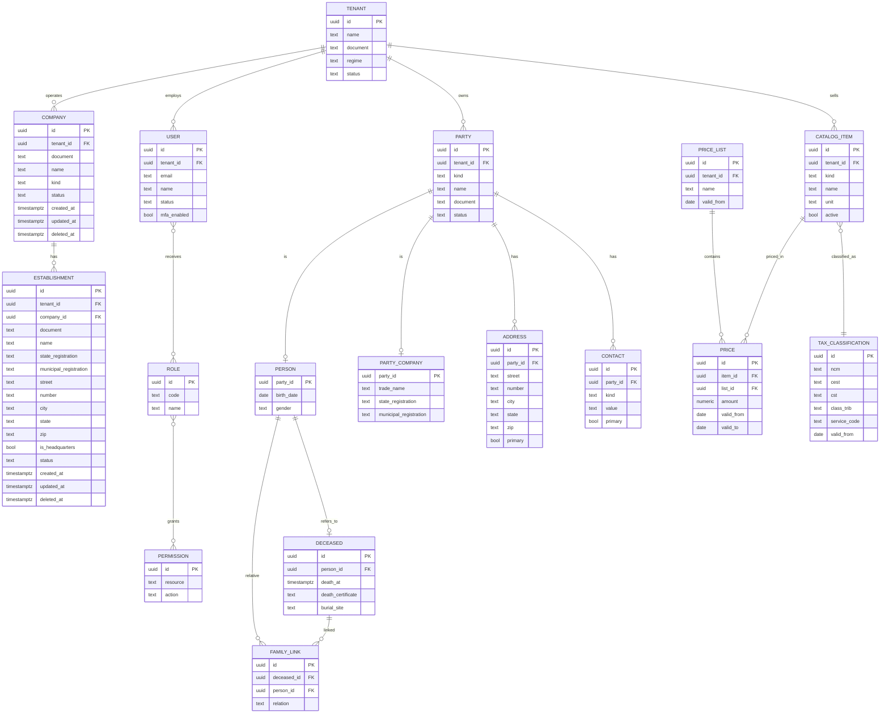
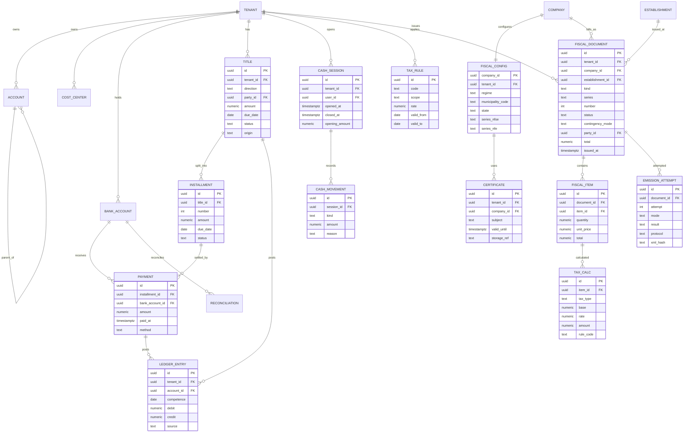
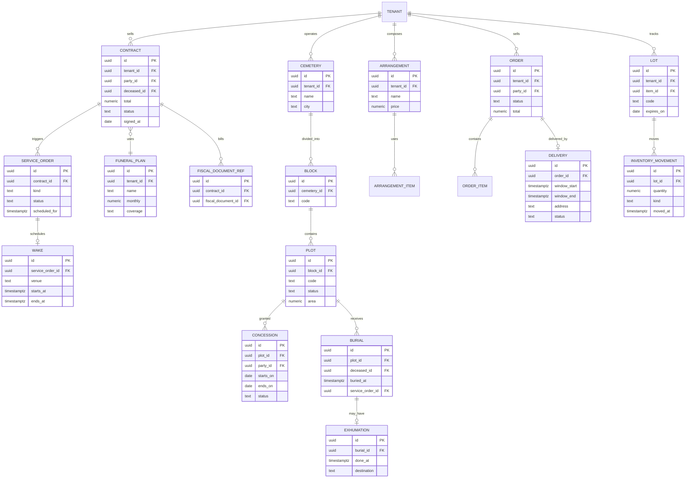
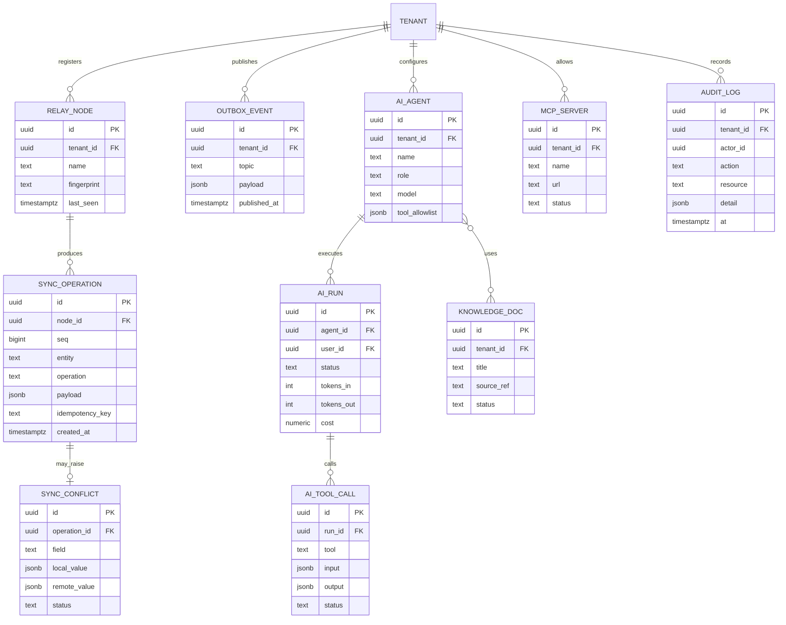
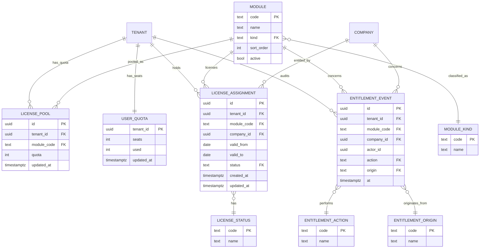

# DER — Amparius

Versão 0.2 · modelo lógico inicial + entidade legal, estabelecimento e entitlement (ADR 0007). Diagramas em Mermaid; nomes em `snake_case`; toda tabela de negócio carrega `tenant_id`.

> **Decisão de nomes (ADR 0007 §7):** `COMPANY` é a **entidade legal operadora** (CNPJ raiz — a funerária, o cemitério, a floricultura). O subtipo de cadastro de PJ cliente/fornecedor, antes chamado `COMPANY`, passa a se chamar **`PARTY_COMPANY`**. Não existem duas entidades com o mesmo nome. `ESTABLISHMENT` substitui `BRANCH`.

## 1. Núcleo: identidade, cadastro e catálogo

## 2. Espinha dorsal: financeiro e fiscal

## 3. Setores: funerário, cemitério e floricultura

> `cremation` é módulo próprio (ADR 0007), **não** sub-funcionalidade de `funeral`; suas entidades (crematório, cremação, urna) são modeladas no módulo `cremation` e não neste bloco inicial.

## 4. Plataforma: sync, IA e auditoria

## 5. Entitlement e módulos — vivem no **control plane**

> **Banco:** o schema `entitlement` e o catálogo `module` pertencem ao **Postgres do control plane** (ADR 0005), junto de billing, diretório de tenants e provisionamento. **Nenhuma dessas tabelas existe na célula.** A célula e o relay guardam apenas um **snapshot assinado** de enforcement (ver nota ao final da seção) — não é tabela de negócio.

**Catálogo `MODULE` — 14 módulos (7 núcleo, 7 opcionais):**

| `kind` | `code` | Observação |
| --- | --- | --- |
| `core` | `identity` | fora da cota |
| `core` | `party` | fora da cota |
| `core` | `catalog` | fora da cota |
| `core` | `finance` | fora da cota |
| `core` | `fiscal` | fora da cota; leitura congelada garantida |
| `core` | `sync` | fora da cota |
| `core` | `reporting` | fora da cota; leitura congelada garantida |
| `optional` | `funeral` | na cota |
| `optional` | `cemetery` | na cota |
| `optional` | `cremation` | na cota; **distinto de `funeral`** |
| `optional` | `floriculture` | na cota |
| `optional` | `inventory` | na cota |
| `optional` | `documents` | na cota |
| `optional` | `ai` | na cota |

**Regras do schema de entitlement:**

- A coluna de módulo é `module_code`, FK para `module.code`; o código é estável e nunca é reciclado. Todos os `text ... FK` de enum acima apontam para a tabela de domínio correspondente (regra 7), nunca para `enum` do Postgres.
- `LICENSE_POOL` é a **cota por módulo por tenant** concedida pelo admin SaaS. A ocupação não é coluna digitada: é contada a partir de `LICENSE_ASSIGNMENT` com licença vigente.
- `LICENSE_ASSIGNMENT`: **1 licença = 1 módulo em 1 empresa (CNPJ)**. `company_id` aponta para `COMPANY`; filial **não** recebe licença — herda da empresa. `valid_from`/`valid_to` são `date` (vigência comercial) e são o gancho de cobrança.
- `USER_QUOTA`: cota de acessos/usuários do tenant (`seats`), com `used` alimentado pelo reporte de ocupação da célula, não por FK entre bancos.
- `ENTITLEMENT_EVENT` é **append-only**: toda ativação/desativação/revogação, por self-service ou admin SaaS, com `actor_id` (usuário do diretório global do control plane, sem FK para a célula) e `at`. Nunca é atualizado nem apagado.
- **Nenhum** desses registros é aceito do corpo da requisição do cliente; `tenant_id` e `company_id` vêm da sessão autenticada.
- **Emissão fiscal** exige cumulativamente: `LICENSE_ASSIGNMENT` vigente para `module_code = 'fiscal'` no `company_id` do fato gerador + `FISCAL_CONFIG`/`CERTIFICATE` daquele `company_id`. Regras de alíquota/CST/NCM continuam vindo exclusivamente das tabelas oficiais datadas (ADR 0004).
- **Snapshot de enforcement (célula e relay):** pacote assinado contendo `version` monotônica e `valid_until` (TTL), derivado destas tabelas. Não vira tabela na célula; o relay aplica **fail-closed** ao expirar e trata `entitlement.revoked` como operação de sync prioritária.

## 6. Regras de modelagem

1. **Chaves**: `uuidv7` em todas as tabelas; `bigint` sequencial só em log de sync por nó.
2. **Tenant**: `tenant_id NOT NULL` + política RLS `USING (tenant_id = current_setting('app.tenant_id')::uuid)`.
3. **Dinheiro**: `NUMERIC(18,2)`; nunca `float`. Totais recalculados no servidor, não confiados do cliente.
4. **Tempo**: `timestamptz` em UTC; competência fiscal é `date`.
5. **Exclusão**: `deleted_at` (soft delete) em cadastros; ledger, fiscal e auditoria nunca são apagados.
6. **Versionamento**: `version int` em entidades sincronizáveis; `updated_at` sempre.
7. **Enums**: códigos estáveis em tabela de domínio, não `enum` do banco, para permitir evolução.
8. **Partições**: `ledger_entry`, `fiscal_document`, `fiscal_item`, `sync_operation`, `ai_run`, `audit_log` e `entitlement_event` por mês (e tenant quando necessário).
9. **Índices**: sempre `(tenant_id, ...)`; busca textual só em `reporting`/índice dedicado.
10. **Fiscal**: `fiscal_document` guarda o XML em object storage com `xml_hash`; o banco guarda metadados e o retorno cru por tentativa.
11. **Empresa e estabelecimento**: `COMPANY` é a entidade legal (CNPJ raiz) e recebe entitlement, `fiscal_config` e `certificate`; `ESTABLISHMENT` (substitui `BRANCH`) é o estabelecimento/filial e herda o entitlement da empresa. Onde o ADR 0003 diz `branch_id`, lê-se `establishment_id`; `company_id` passa a ser escopo secundário adicional nas políticas de acesso.
12. **Fronteira control plane**: `module` e `entitlement` vivem no Postgres do control plane; célula e relay só mantêm o snapshot assinado de enforcement (versão + TTL). Nenhuma cópia de tabela de licença na célula.
13. **Migração fiscal forward-only**: `fiscal_config` sai de `tenant_id PK` para `company_id PK` e `certificate` troca `tenant_id` por `company_id` em **migração nova**; a migração existente não é editada. A carga inicial exige `COMPANY` criada por tenant antes do `NOT NULL`.
14. **Fiscal não se estima**: nenhuma coluna deste modelo (nem `tax_rule`, nem `tax_calculation`) carrega alíquota, CST, cClassTrib, NCM ou CFOP fixos; valores vêm de tabela oficial datada, consultada pela data de competência.
