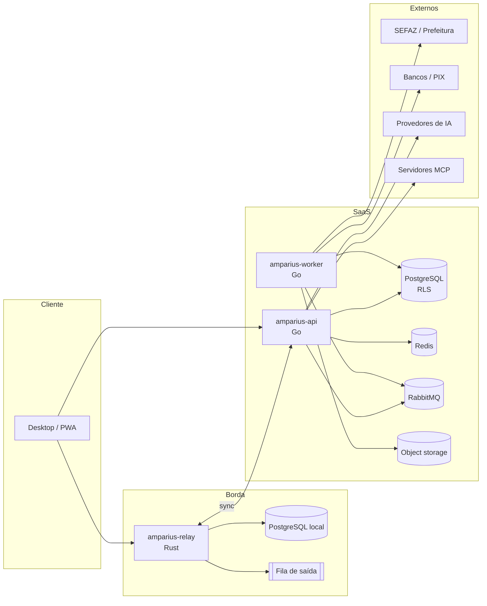
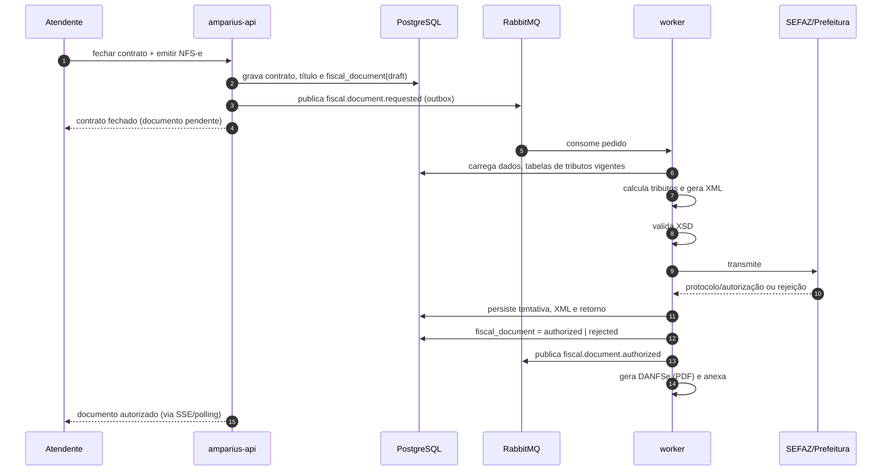
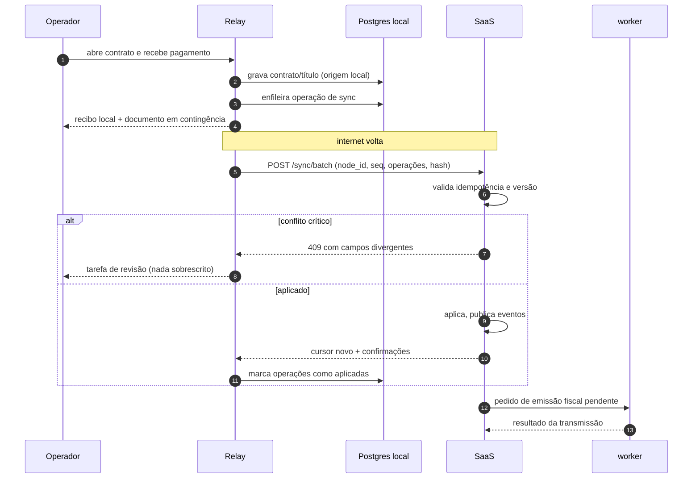
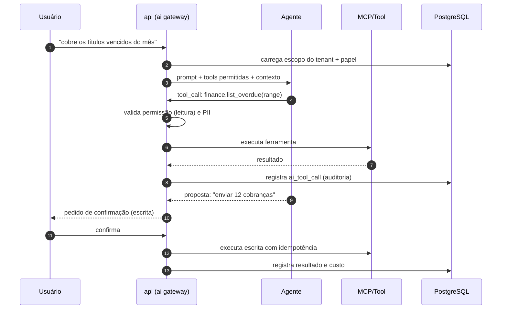
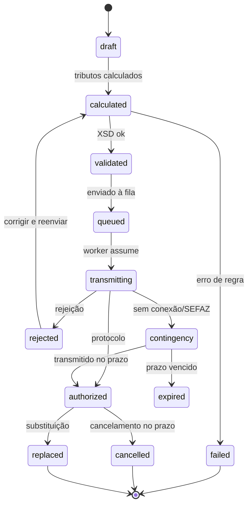
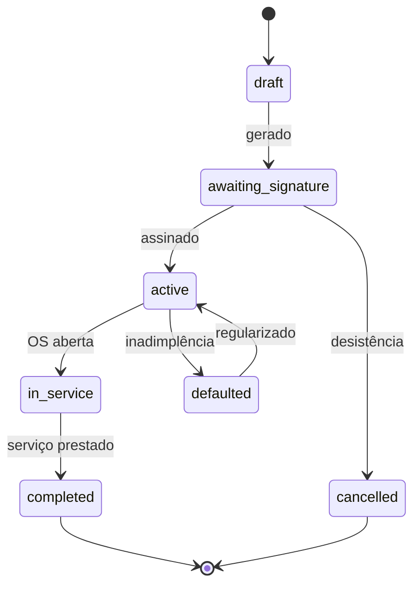
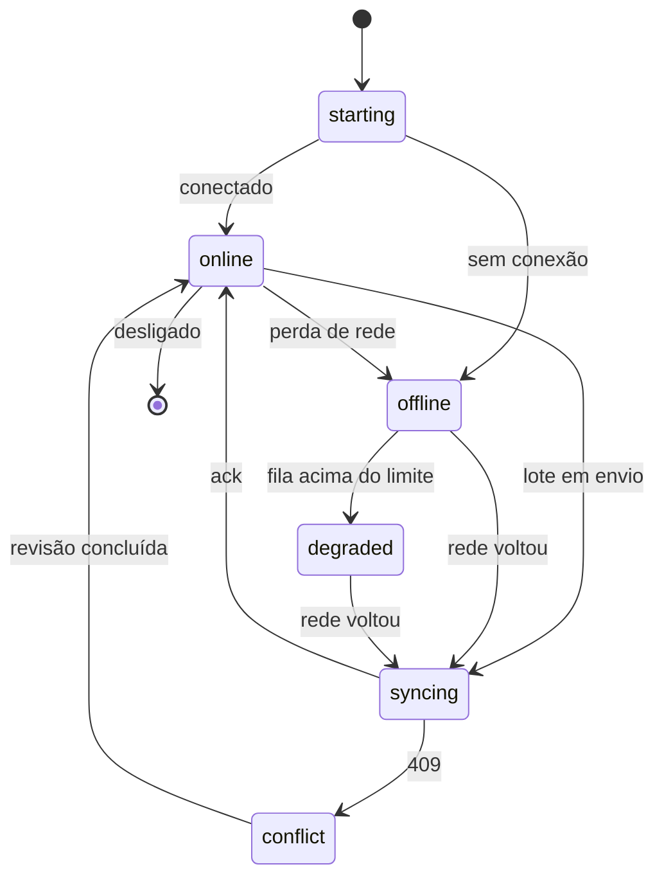
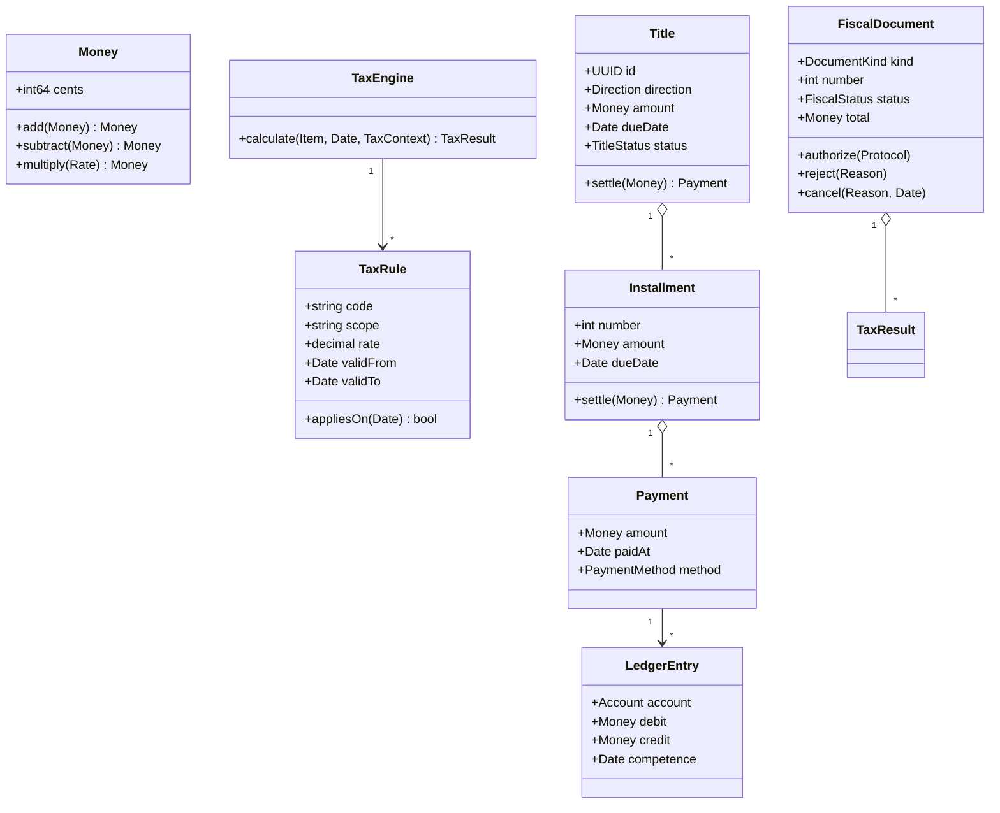

# UML — Amparius

Versão 0.1 · diagramas de componentes, sequência, estados e classes.

## 1. Componentes

## 2. Sequência — emissão fiscal online

## 3. Sequência — operação offline e sincronização

## 4. Sequência — agente de IA com ferramenta protegida

## 5. Estados

### 5.1 Documento fiscal

### 5.2 Contrato funerário

### 5.3 Relay

## 6. Classes — núcleo financeiro

